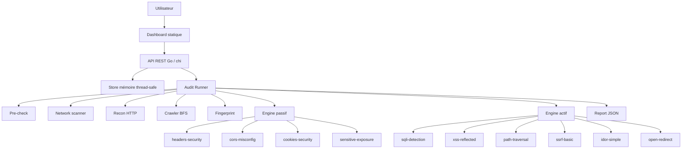

# AuditCore - Vulnerability Scanner

> Plateforme d'audit web automatisé en Go : reconnaissance, crawl, fingerprint, détection passive et active, scoring, replay et dashboard web. 🔎

<p align="center">
  
  
  
  
  
</p>

AuditCore est une application d'audit de sécurité web conçue pour automatiser les premières étapes d'une analyse applicative : validation de cible, empreinte réseau, reconnaissance HTTP, crawl, fingerprint technologique, détection de vulnérabilités, qualification des findings et restitution dans un dashboard. 🛡️

Le projet inclut une API REST en Go, un moteur de scan modulaire, un store mémoire thread-safe et une interface web statique servie par le backend.

> [!IMPORTANT]
> Utilisez AuditCore uniquement sur des cibles que vous possédez ou pour lesquelles vous disposez d'une autorisation explicite. Les modules actifs envoient des payloads de test et peuvent être intrusifs selon la cible.

---

## Table des matières

- [Aperçu](#aperçu)
- [Objectifs](#objectifs)
- [Fonctionnalités principales](#fonctionnalités-principales)
- [Captures d'écran](#captures-décran)
- [Architecture](#architecture)
- [Arborescence du projet](#arborescence-du-projet)
- [Technologies](#technologies)
- [Prérequis](#prérequis)
- [Installation](#installation)
- [Configuration](#configuration)
- [Lancement](#lancement)
- [Commandes utiles](#commandes-utiles)
- [API REST](#api-rest)
- [Modules de scan](#modules-de-scan)
- [Modèle de données](#modèle-de-données)
- [Exemples d'utilisation](#exemples-dutilisation)
- [Tests](#tests)
- [Développement](#développement)
- [Docker](#docker)
- [Sécurité et bonnes pratiques](#sécurité-et-bonnes-pratiques)
- [Contribution](#contribution)
- [Roadmap](#roadmap)
- [Problèmes connus](#problèmes-connus)
- [FAQ](#faq)
- [Licence](#licence)
- [Remerciements](#remerciements)
- [Contact](#contact)
- [À compléter](#à-compléter)

---

## Aperçu

AuditCore exécute un pipeline d'audit complet sur une URL cible :

```text
pre-check -> network -> recon -> crawl -> fingerprint -> prioritize
          -> passive scan -> active scan -> scoring -> report
```

Le dashboard permet de :

- lancer rapidement un audit ;
- suivre la progression en temps réel par polling ;
- consulter les résultats de chaque phase ;
- explorer les assets découverts ;
- filtrer et qualifier les findings ;
- rejouer certaines preuves ;
- générer des exports côté navigateur.

> [!NOTE]
> Le stockage actuel est en mémoire. Les audits, events, assets, findings et rapports sont perdus au redémarrage du serveur.

---

## Objectifs

- Fournir une base solide pour un scanner web open source écrit en Go.
- Automatiser les phases de reconnaissance et de détection courantes.
- Centraliser les preuves techniques dans une API et une interface lisible.
- Classer les vulnérabilités par sévérité, confiance, statut et score.
- Faciliter la lecture du projet par des développeurs, recruteurs, enseignants ou contributeurs.

---

## Fonctionnalités principales

| Catégorie | Fonctionnalités |
|---|---|
| Audit 🚀 | Création d'audit asynchrone, arrêt d'audit, suivi par phase, event stream |
| Pre-check ✅ | Normalisation d'URL, HEAD puis GET fallback, URL finale, temps de réponse |
| Network 🌐 | Résolution DNS, scan de ports TCP courants, inspection TLS |
| Recon 🧭 | Headers, title HTML, server, robots.txt, sitemap.xml, liens internes |
| Crawl 🕸️ | BFS, profondeur et volume configurables, extraction de liens, formulaires et routes JS |
| Fingerprint 🧬 | Détection framework, CMS, serveur, langage, mécanisme d'authentification |
| Scans passifs 🔍 | Security headers, CORS, cookies, exposition de ressources sensibles |
| Scans actifs ⚙️ | SQLi, XSS, path traversal, SSRF, IDOR, open redirect |
| Findings 🧾 | Sévérité, confiance, statut, CWE, OWASP, ASVS, preuves, remédiations |
| Replay 🔁 | Rejeu contrôlé des preuves replayables et progression de statut |
| Reporting 📄 | Rapport JSON serveur, exports PDF/JSON/DOCX côté dashboard |
| Dashboard 📊 | Portfolio, timeline, audit detail, findings, assets, network, GRC, reports, profiles |

---

## Captures d'écran

Les emplacements ci-dessous sont prévus pour documenter l'interface.

| Vue | Capture |
|---|---|
| Portfolio des audits | `docs/screenshots/portfolio.png` - à ajouter |
| Timeline live | `docs/screenshots/timeline.png` - à ajouter |
| Centre des findings | `docs/screenshots/findings.png` - à ajouter |
| Détail réseau | `docs/screenshots/network.png` - à ajouter |
| Rapport / GRC | `docs/screenshots/report.png` - à ajouter |

> [!TIP]
> Créez un dossier `docs/screenshots/` puis remplacez ces placeholders par de vraies images du dashboard.

---

## Architecture



### Principes internes

- Le runner ne communique pas directement avec le dashboard.
- Le runner écrit les résultats dans le store.
- Le dashboard lit l'état via l'API REST.
- Les modules de scan implémentent une interface commune.
- Le client HTTP central applique le scope, les headers, l'auth et le rate limit.

---

## Arborescence du projet

```text
.
├── .github/
│   └── workflows/
│       └── scan.yml              # Workflow présent, actuellement vide
├── cmd/
│   └── api/
│       └── main.go               # Point d'entrée du serveur API + dashboard
├── internal/
│   ├── api/                      # Router chi et handlers REST
│   ├── audit/                    # Orchestrateur du pipeline d'audit
│   ├── crawler/                  # Crawl BFS, liens, formulaires, routes JS
│   ├── fingerprint/              # Détection de stack technique
│   ├── httpx/                    # Client HTTP, scope, auth, rate limit
│   ├── models/                   # Modèles métier et payloads JSON
│   ├── network/                  # DNS, ports TCP, TLS
│   ├── recon/                    # Pre-check et reconnaissance HTTP
│   ├── report/                   # Scoring et rapport JSON
│   ├── scanner/
│   │   ├── engine/               # Dispatcher de modules
│   │   ├── matchers/             # Matchers réutilisables
│   │   ├── modules/              # Modules passifs et actifs
│   │   └── replay/               # Rejeu de preuves
│   └── storage/                  # Store mémoire thread-safe
├── tests/
│   └── router.test.js            # Tests Node du routeur dashboard
├── web/
│   └── dashboard/
│       ├── index.html            # Dashboard principal
│       ├── dashboard.js          # Client API historique / helpers UI
│       ├── findings.js           # Centre de findings, exports, replay
│       └── router.js             # Router SPA et historique navigateur
├── go.mod
├── go.sum
├── Makefile
└── README.md
```

---

## Technologies

| Technologie | Version / état | Usage |
|---|---:|---|
| Go | 1.22 | Backend, API, moteur de scan |
| chi | v5.0.12 | Router HTTP |
| go-chi/cors | v1.2.1 | Middleware CORS |
| google/uuid | v1.6.0 | Génération d'identifiants |
| golang.org/x/net | v0.24.0 | Parsing HTML |
| HTML/CSS/JavaScript | Vanilla | Dashboard statique |
| Node.js test runner | À compléter | Tests `tests/router.test.js` |
| Make | Optionnel | Commandes de développement |

---

## Prérequis

- Go `1.22` ou supérieur.
- Un terminal compatible avec les commandes Go.
- `make` si vous souhaitez utiliser le `Makefile`.
- `curl` pour les exemples API.
- Node.js si vous souhaitez exécuter les tests JavaScript.

> [!WARNING]
> Le projet lance des requêtes réseau vers les cibles auditées. Assurez-vous d'avoir les droits nécessaires avant d'exécuter un scan.

---

## Installation

```bash
git clone <url-du-repository>
cd Vulnerability-Scanner/vuln-scanner
go mod tidy
```

Vérifier que le projet compile :

```bash
go build ./...
```

Ou avec le Makefile :

```bash
make tidy
make check
```

---

## Configuration

### Variables d'environnement

| Variable | Défaut | Description |
|---|---:|---|
| `PORT` | `8080` | Port d'écoute du serveur API |

Exemple :

```bash
PORT=9090 go run ./cmd/api/
```

Sous PowerShell :

```powershell
$env:PORT="9090"
go run ./cmd/api/
```

### Options d'audit

Les options peuvent être envoyées dans le body JSON de `POST /api/audits`.

```json
{
  "target_url": "https://example.com",
  "options": {
    "allowed_hosts": ["example.com"],
    "excluded_paths": ["/admin", "/logout"],
    "max_depth": 3,
    "max_pages": 150,
    "rate_limit_rps": 4,
    "user_agent": "AuditCore/3.0",
    "headers": {
      "X-Audit-Id": "demo"
    },
    "cookies": {
      "session": "value"
    },
    "bearer_token": "token",
    "basic_username": "user",
    "basic_password": "password"
  }
}
```

| Option | Description |
|---|---|
| `allowed_hosts` | Hôtes autorisés pour limiter le périmètre |
| `excluded_paths` | Préfixes de chemins exclus |
| `max_depth` | Profondeur de crawl |
| `max_pages` | Nombre maximal de pages visitées |
| `rate_limit_rps` | Limite de requêtes par seconde |
| `user_agent` | User-Agent personnalisé |
| `headers` | Headers HTTP additionnels |
| `cookies` | Cookies ajoutés aux requêtes |
| `bearer_token` | Authentification Bearer |
| `basic_username` / `basic_password` | Authentification Basic |

---

## Lancement

### Mode développement

```bash
go run ./cmd/api/
```

Avec Make :

```bash
make run
```

Serveur disponible sur :

```text
http://localhost:8080/
```

### Port personnalisé

```bash
go run ./cmd/api/ -port=9090
```

Avec Make :

```bash
make run-port PORT=9090
```

### Dashboard personnalisé

Le binaire auto-détecte `web/dashboard`. Vous pouvez aussi fournir un chemin :

```bash
go run ./cmd/api/ -dash=./web/dashboard
```

---

## Commandes utiles

| Commande | Description |
|---|---|
| `make run` | Lance l'API et sert le dashboard |
| `make run-port PORT=9090` | Lance le serveur sur un port personnalisé |
| `make build` | Compile le binaire dans `bin/auditcore` |
| `make tidy` | Synchronise les dépendances Go |
| `make check` | Vérifie la compilation |
| `make test` | Lance les tests Go |
| `make clean` | Supprime les binaires générés |
| `make audit-example` | Lance un audit d'exemple via curl |
| `make health` | Vérifie `/api/health` |

Commandes équivalentes sans Make :

```bash
go run ./cmd/api/
go build ./...
go test ./...
```

---

## API REST

### Santé et statistiques

| Méthode | Endpoint | Description |
|---|---|---|
| `GET` | `/api/health` | Vérifie l'état de l'API |
| `GET` | `/api/stats` | Retourne les statistiques globales en mémoire |

### Audits

| Méthode | Endpoint | Description |
|---|---|---|
| `POST` | `/api/audits` | Crée et lance un audit |
| `GET` | `/api/audits` | Liste les audits |
| `GET` | `/api/audits/{id}` | Détail complet d'un audit |
| `POST` | `/api/audits/{id}/stop` | Stoppe un audit en cours |

### Résultats de phases

| Méthode | Endpoint | Description |
|---|---|---|
| `GET` | `/api/audits/{id}/events?since=<RFC3339Nano>` | Événements de scan |
| `GET` | `/api/audits/{id}/precheck` | Résultat pre-check |
| `GET` | `/api/audits/{id}/network` | Résultat réseau |
| `GET` | `/api/audits/{id}/recon` | Résultat reconnaissance |
| `GET` | `/api/audits/{id}/fingerprint` | Fingerprint technique |
| `GET` | `/api/audits/{id}/crawl` | Résultat crawl |
| `GET` | `/api/audits/{id}/assets` | Assets découverts |
| `GET` | `/api/audits/{id}/report` | Rapport JSON |

### Findings

| Méthode | Endpoint | Description |
|---|---|---|
| `GET` | `/api/audits/{id}/findings` | Liste les findings |
| `PATCH` | `/api/audits/{id}/findings/{fid}` | Met à jour le statut |
| `POST` | `/api/audits/{id}/findings/{fid}/replay` | Rejoue une preuve |

### Filtres supportés

| Endpoint | Paramètres |
|---|---|
| `/events` | `since` |
| `/assets` | `method`, `type`, `q` |
| `/findings` | `severity`, `status`, `q` |

---

## Modules de scan

### Modules passifs

| Module | Taxonomie | Détection |
|---|---|---|
| `headers-security` | `WEB-HDRS-001..006` | Headers de sécurité manquants |
| `cors-misconfig` | `WEB-CORS-001..002` | CORS wildcard ou origine arbitraire reflétée |
| `cookies-security` | `WEB-COOK-001..003` | Flags `HttpOnly`, `Secure`, `SameSite` manquants |
| `sensitive-exposure` | `WEB-EXP-001..002` | Fichiers sensibles exposés, directory listing |

### Modules actifs

| Module | Taxonomie | Détection |
|---|---|---|
| `sqli-detection` | `WEB-SQLI-001` | SQLi error-based et boolean-based |
| `xss-reflected` | `WEB-XSS-002` | XSS réfléchi |
| `path-traversal` | `WEB-PATH-001` | Traversée de répertoires |
| `ssrf-basic` | `WEB-SSRF-001` | SSRF vers metadata cloud et ressources locales |
| `idor-simple` | `WEB-IDOR-001` | IDOR simple sur identifiants numériques |
| `open-redirect` | `WEB-REDIR-001` | Redirection ouverte |

---

## Modèle de données

### Statuts d'audit

```text
pending -> running -> done
                  -> failed
                  -> stopped
```

### Phases

```text
pre-check
network
recon
crawl
fingerprint
prioritize
passive
active
validation
scoring
report
idle
```

### Qualification des findings

| Champ | Valeurs |
|---|---|
| Sévérité | `critical`, `high`, `medium`, `low`, `info` |
| Confiance | `high`, `medium`, `low` |
| Statut | `suspected`, `validated`, `confirmed`, `false_positive`, `accepted_risk` |

### Scoring

Le score d'un finding combine :

- la sévérité ;
- la confiance ;
- le statut ;
- un bornage entre `0` et `100`.

Le score global d'audit est calculé à partir des 5 findings les plus importants, avec pondération décroissante.

---

## Exemples d'utilisation

### Vérifier l'API

```bash
curl http://localhost:8080/api/health
```

Réponse attendue :

```json
{
  "status": "ok",
  "time": "2026-07-04T12:00:00Z",
  "version": "2.0.0"
}
```

### Lancer un audit minimal

```bash
curl -X POST http://localhost:8080/api/audits \
  -H "Content-Type: application/json" \
  -d '{"target_url":"https://example.com"}'
```

### Lancer un audit borné

```bash
curl -X POST http://localhost:8080/api/audits \
  -H "Content-Type: application/json" \
  -d '{
    "target_url": "https://example.com",
    "options": {
      "allowed_hosts": ["example.com"],
      "excluded_paths": ["/admin"],
      "max_depth": 2,
      "max_pages": 50,
      "rate_limit_rps": 2
    }
  }'
```

### Lire les findings critiques confirmés

```bash
curl "http://localhost:8080/api/audits/<audit_id>/findings?severity=critical&status=confirmed"
```

### Qualifier un finding

```bash
curl -X PATCH http://localhost:8080/api/audits/<audit_id>/findings/<finding_id> \
  -H "Content-Type: application/json" \
  -d '{"status":"confirmed"}'
```

### Rejouer une preuve

```bash
curl -X POST http://localhost:8080/api/audits/<audit_id>/findings/<finding_id>/replay
```

### Générer un rapport JSON

```bash
curl http://localhost:8080/api/audits/<audit_id>/report
```

---

## Tests

### Tests Go

```bash
go test ./...
```

ou :

```bash
make test
```

Les tests Go présents couvrent notamment :

- le fallback SPA du dashboard ;
- le scope HTTP (`AllowedHosts`, `ExcludedPaths`) ;
- l'extraction de formulaires par le crawler ;
- le scoring des rapports ;
- la mise à jour de statuts et timestamps dans le store.

### Tests JavaScript

```bash
node --test tests/router.test.js
```

Les tests JavaScript couvrent le router SPA :

- navigation historique ;
- retour / avance navigateur ;
- restauration d'un panneau finding ;
- routes directes ;
- redirection de routes inconnues.

> [!NOTE]
> La version Node.js minimale n'est pas documentée dans le projet. À compléter si une version cible est définie.

---

## Développement

### Ajouter un module de scan

1. Créer un package dans `internal/scanner/modules/<nom>`.
2. Implémenter l'interface :

```go
type Module interface {
    Name() string
    Run(ctx *models.ModuleContext, client *http.Client) *models.ModuleResult
}
```

3. Retourner des `models.Finding` avec :

- `TaxonomyID`
- `Type`
- `Title`
- `Severity`
- `Confidence`
- `Status`
- `Description`
- `Remediation`
- `Evidence`

4. Enregistrer le module dans `internal/audit/runner.go`.
5. Ajouter des tests ciblés.

### Bonnes pratiques

- Garder les modules indépendants.
- Respecter le scope via `httpx.NewClient`.
- Éviter les tests destructifs.
- Limiter les payloads et le volume de requêtes.
- Renseigner les preuves sans exposer inutilement de secrets.
- Ajouter une taxonomie stable pour chaque nouveau finding.
- Prévoir les faux positifs et les niveaux de confiance.

### Branches Git

Convention proposée :

| Type | Format |
|---|---|
| Feature | `feature/<nom-court>` |
| Fix | `fix/<nom-court>` |
| Documentation | `docs/<nom-court>` |
| Refactor | `refactor/<nom-court>` |

> [!NOTE]
> Aucune convention de branches n'est actuellement documentée dans le dépôt. Cette proposition est à valider.

---

## Docker

Aucun `Dockerfile` ni `docker-compose.yml` n'est présent dans le projet à ce stade.

### À compléter

- Ajouter un `Dockerfile` multi-stage pour compiler le binaire Go.
- Ajouter un `docker-compose.yml` si une base de données ou une file de jobs est introduite.
- Documenter les variables d'environnement de production.

Exemple cible à formaliser plus tard :

```bash
docker build -t auditcore .
docker run --rm -p 8080:8080 auditcore
```

---

## Sécurité et bonnes pratiques

> [!CAUTION]
> AuditCore peut générer du trafic offensif de test. Ne lancez jamais d'audit actif sur une cible sans autorisation.

Points de vigilance avant production :

- Ajouter une authentification.
- Ajouter des rôles et permissions.
- Restreindre la configuration CORS.
- Persister les données dans une base durable.
- Chiffrer les secrets et preuves sensibles.
- Masquer les tokens, cookies et credentials dans les rapports.
- Journaliser les actions sensibles.
- Ajouter une politique de rétention des données.
- Définir un cadre RGPD clair.

---

## Contribution

Les contributions sont les bienvenues lorsque le cadre du projet sera formalisé.

### Workflow proposé

1. Forker le dépôt.
2. Créer une branche dédiée.
3. Implémenter la modification.
4. Ajouter ou mettre à jour les tests.
5. Lancer :

```bash
go test ./...
node --test tests/router.test.js
```

6. Ouvrir une pull request avec :

- le contexte ;
- les changements ;
- les tests effectués ;
- les limites ou impacts sécurité.

### Standards attendus

- Code lisible et modulaire.
- Pas de dépendances inutiles.
- Documentation des nouvelles options ou endpoints.
- Tests pour les changements à risque.
- Respect du périmètre de scan.

---

## Roadmap

| Priorité | Évolution | Statut |
|---:|---|---|
| P0 | Authentification et contrôle d'accès | À faire |
| P0 | Persistance PostgreSQL | À faire |
| P0 | CORS restreint en production | À faire |
| P1 | Dockerfile et Docker Compose | À faire |
| P1 | OpenAPI / Swagger | À faire |
| P1 | Rapports PDF/DOCX côté serveur | À faire |
| P1 | Profils de scan persistés | À faire |
| P2 | Planification d'audits | À faire |
| P2 | Notifications webhook / Slack / email | À faire |
| P2 | Détection JWT, GraphQL, rate limit | À faire |
| P2 | Multi-projets et multi-utilisateurs | À faire |

---

## Problèmes connus

| Sujet | Description |
|---|---|
| Stockage mémoire | Les données disparaissent au redémarrage |
| Authentification | Aucun login ni RBAC implémenté |
| CORS API | Origines autorisées à `*` |
| CI GitHub | `.github/workflows/scan.yml` existe mais est vide |
| Docker | Aucun fichier Docker présent |
| Rapport serveur | Le rapport serveur est JSON ; PDF/DOCX serveur reste à implémenter |
| Faux positifs | Certains matchers heuristiques peuvent nécessiter une validation manuelle |
| Encodage historique | L'ancien README contenait des caractères mal encodés |

---

## FAQ

### AuditCore remplace-t-il un audit manuel ?

Non. AuditCore automatise une première analyse et aide à prioriser les risques. Les findings doivent être relus, validés et contextualisés par une personne compétente.

### Puis-je scanner n'importe quel site ?

Non. Vous devez avoir une autorisation explicite. Les tests actifs peuvent déclencher des alertes ou perturber une cible fragile.

### Les données sont-elles persistées ?

Non. Le store actuel est en mémoire. Une base durable est recommandée pour tout usage sérieux.

### Le dashboard est-il un frontend séparé ?

Non. Il est statique et servi directement par le serveur Go depuis `web/dashboard`.

### Les rapports PDF/DOCX sont-ils générés par le backend ?

Pas actuellement. Le backend génère un rapport JSON. Le dashboard contient des exports côté navigateur, tandis que les rapports PDF/DOCX serveur sont à formaliser.

---

## Licence

À compléter.

Le dépôt ne contient pas encore de fichier `LICENSE`. Ajoutez une licence open source adaptée avant toute publication officielle.

---

## Remerciements

Ce projet s'appuie notamment sur :

- l'écosystème Go ;
- `go-chi/chi` pour le routing HTTP ;
- `go-chi/cors` pour la gestion CORS ;
- `google/uuid` pour les identifiants ;
- `golang.org/x/net/html` pour le parsing HTML.

---

## Contact

À compléter.

Suggestions d'informations utiles :

- mainteneur principal ;
- email de contact ;
- lien GitHub ;
- lien de démonstration ;
- politique de disclosure sécurité.

---

## À compléter

- [ ] Licence officielle.
- [ ] Fichier `LICENSE`.
- [ ] Nom du mainteneur.
- [ ] Contact sécurité.
- [ ] URL du repository public.
- [ ] Captures d'écran réelles.
- [ ] Version Node.js cible.
- [ ] Workflow CI complet.
- [ ] Documentation OpenAPI.
- [ ] Guide de déploiement production.
- [ ] Dockerfile et Docker Compose.
- [ ] Politique RGPD et rétention des données.
- [ ] Politique de contribution officielle.
- [ ] Code of Conduct si publication open source.
- [ ] Security Policy / `SECURITY.md`.
